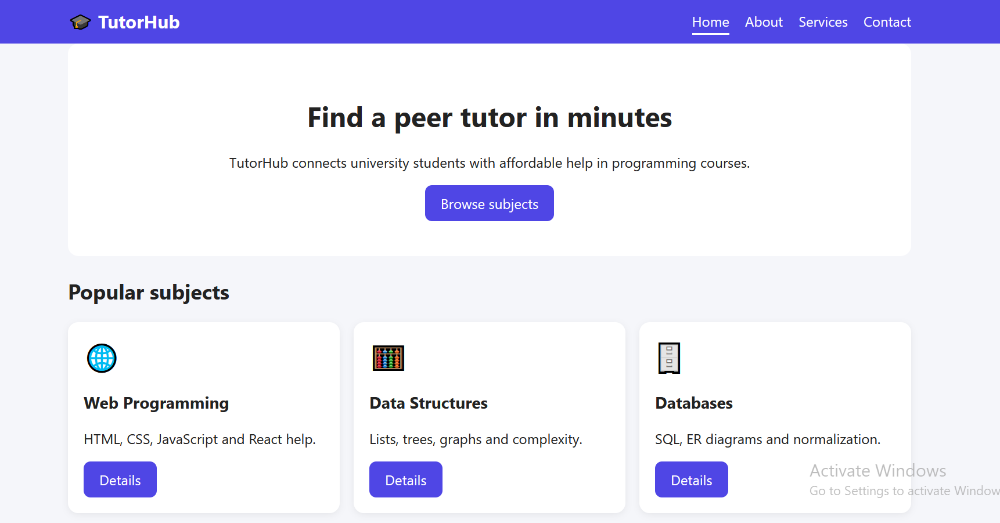
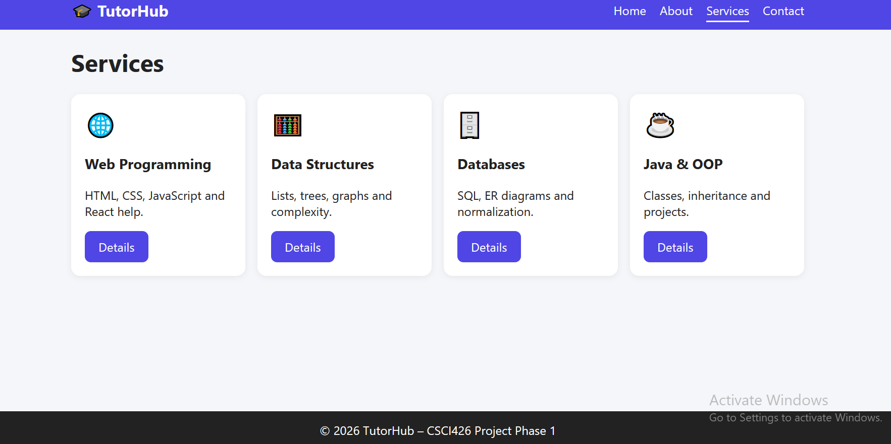
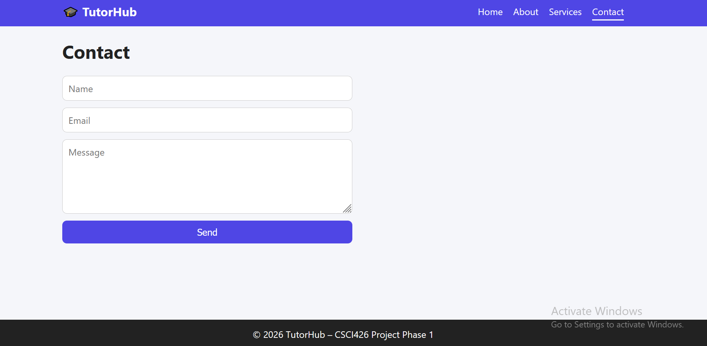

# TutorHub – CSCI426 Project Phase 1

## Project Description
TutorHub is a responsive React web app that solves a real-world problem: students struggle to find affordable tutoring for programming courses. The site lists subjects, prices and a booking/contact form.

**Pages:** Home, About, Services (with search), Service Details (dynamic route `/services/:id`), Contact (validated form).

**Tech:** React 18, React Router v6, Vite, plain responsive CSS (Flexbox/Grid + media queries).

## Setup Instructions
```bash
git clone <https://github.com/elk0644/tutorhub-project.git>
cd tutorhub
npm install
npm run dev        # open http://localhost:5173
npm run build      # production build in /dist
```

## Deployment
Deployed on Vercel/Netlify/GitHub Pages: **<https://tutorhub-project.vercel.app>** (uses HashRouter so routes work on any static host).

## Screenshots
| Home | Services | Contact (mobile) |
|---|---|---|
|  |  |  |

*(Run the app, take the screenshots and save them in `docs/screenshots/` with these names.)*

## Structure
```
src/
 ├── components/ Navbar, Footer, ServiceCard
 ├── pages/      Home, About, Services, ServiceDetail, Contact
 ├── data.js     services data
 ├── App.jsx     routes
 └── main.jsx    entry
```
